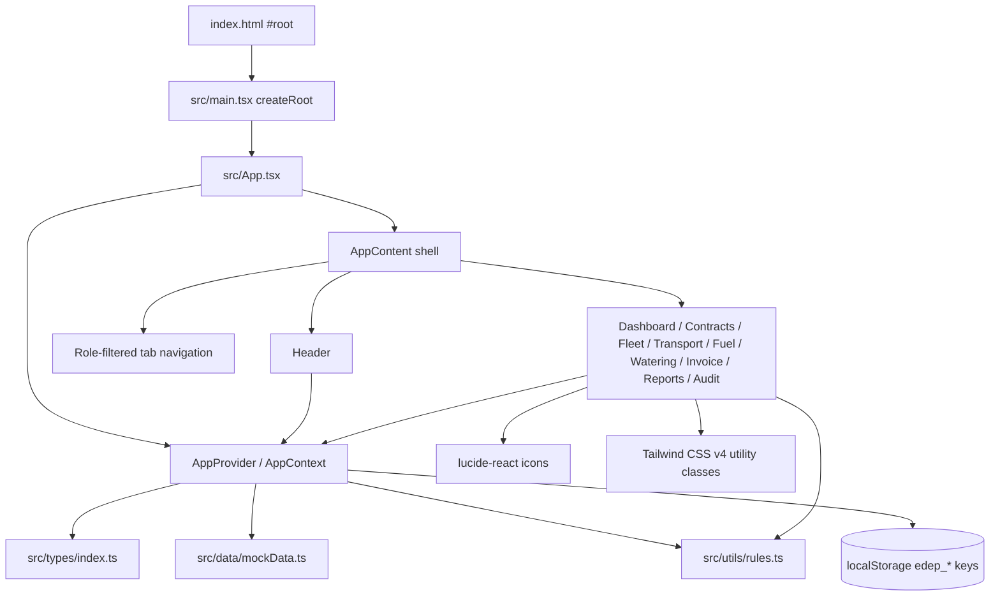

# Architecture

## Overview

EDEP CONNECT is a client-only React 19 single-page application built with Vite and TypeScript. The application models an integrated mining/logistics business (contracts, fleet, bauxite transport, watering, fuel, invoicing, audit) and runs entirely against seeded in-memory data persisted to `localStorage`. There is no backend, API client, authentication service, or URL router in the current source tree.

The architectural center is a single React context (`AppProvider`) that owns all business collections and mutation operations. `App.tsx` renders one of nine view components based on a local `activeTab` state value. Pure business calculations and separation-of-duties checks live in `src/utils/rules.ts`; domain types live in `src/types/index.ts`; seed records live in `src/data/mockData.ts`.

## High-Level Pattern

**Overall:** SPA + context-owned application state + conditional view switching + localStorage persistence.

**Key characteristics:**
- One provider wraps the entire application (`src/App.tsx:170-176`).
- A single `useApp()` hook is the only state/action access path for views (`src/context/AppContext.tsx:1000-1006`).
- Views are statically imported and rendered by tab ID; no route library is used (`src/App.tsx:155-163`).
- Reads are computed inside views with `filter`/`reduce`; writes go through context action closures.
- Every mutation that matters appends an audit record through the private `logAudit` helper (`src/context/AppContext.tsx:270-293`).
- Persistence is a set of per-slice `useEffect` writes to `localStorage`; initial state is read lazily from the same keys (`src/context/AppContext.tsx:139-268`).

## System / Component Diagram

## Layers

| Layer | Location | Responsibility | Depends on |
|---|---|---|---|
| Shell / navigation | `src/App.tsx`, `src/components/Header.tsx` | Layout, tab selection, responsive sidebar/drawer, role switcher, offline toggle, sync trigger | Context |
| Feature views | `src/components/*View.tsx` | Screens, forms, tables, modals, local filter/form state, derived display values | Context, `rules.ts`, lucide-react |
| Application state | `src/context/AppContext.tsx` | Collections, mutations, permissions, audit logging, offline queue, persistence | Types, seed data, rules |
| Domain model | `src/types/index.ts` | Interfaces and string-literal unions for all entities | None |
| Business rules | `src/utils/rules.ts` | Pure calculations, SOD checks, currency formatting | Types |
| Seed data | `src/data/mockData.ts` | `INITIAL_*` arrays used when no localStorage value exists | Types |
| Styling | `src/index.css` | Single Tailwind v4 import | Tailwind/Vite |
| Entry/bootstrap | `index.html`, `src/main.tsx` | Root element, module bootstrap, global CSS | React DOM |

## Routing and Navigation

There is no routing library and no URL synchronization. `TabId` is a local union in `src/App.tsx:27-36`; `activeTab` defaults to `dashboard` (`src/App.tsx:40`). Navigation is an array of `NAV_ITEMS` with IDs, labels, and lucide icons (`src/App.tsx:47-57`).

Visibility is role-filtered before rendering:
- `client` sees only dashboard, transport, invoices (`src/App.tsx:59-62`).
- `chauffeur` sees transport, fleet, fuel, watering (`src/App.tsx:63-65`).
- All other roles see every item (`src/App.tsx:66`).

Desktop navigation is a sticky sidebar (`src/App.tsx:77-108`); mobile uses a toggleable drawer (`src/App.tsx:110-151`). The active view is rendered by a chain of conditional expressions (`src/App.tsx:155-163`). Consequences: no deep links or browser back/forward, and local state inside a view is lost whenever the user switches tabs because the previous view unmounts.

## State Management Model

`AppContext.tsx` does **not** use `useReducer`, Redux, Zustand, or React Query. It uses 14 `useState` slices and exposes action functions that close over the current render's state. The context value is a new object on every provider render (`src/context/AppContext.tsx:952-998`).

| State slice | Initialization | Persistence key | Main actions |
|---|---|---|---|
| `currentUser` | saved user or `INITIAL_USERS[0]` (`:139-142`) | `edep_user` (`:214-216`) | `setCurrentUser` |
| `users` | fixed `INITIAL_USERS` (`:144`) | none | none (role simulator list) |
| `isOfflineMode` | `false` (`:145`) | none | `toggleOfflineMode` (`:295-297`) |
| `offlineQueue` | saved queue or `[]` (`:146-149`) | `edep_offline_queue` (`:266-268`) | `synchronizeOfflineQueue` (`:300-338`) |
| `contracts` | saved or seed (`:151-154`) | `edep_contracts` (`:218-220`) | `addContract`, `updateContractStatus` |
| `vehicles` | saved or seed (`:156-159`) | `edep_vehicles` (`:222-224`) | `addVehicle`, `updateVehicleStatus`, breakdown side effects |
| `drivers` | fixed seed (`:161`) | none | none |
| `trips` | saved or seed (`:163-166`) | `edep_trips` (`:226-228`) | `addTrip`, `validateTrip`, offline sync |
| `cisterns` | saved or seed (`:168-171`) | `edep_cisterns` (`:230-232`) | stock adjustments in fuel actions |
| `fuelMovements` | saved or seed (`:173-176`) | `edep_fuel_movements` (`:234-236`) | `addFuelMovement`, offline sync |
| `fuelInventories` | saved or seed (`:178-181`) | `edep_fuel_inventories` (`:238-240`) | `recordFuelInventory`, `validateFuelDiscrepancy` |
| `wateringRuns` | saved or seed (`:183-186`) | `edep_watering` (`:242-244`) | `addWateringRun`, `validateWateringRun` |
| `breakdowns` | saved or seed (`:188-191`) | `edep_breakdowns` (`:246-248`) | `reportBreakdown`, `resolveBreakdown` |
| `invoices` | saved or seed (`:193-196`) | `edep_invoices` (`:250-252`) | `createInvoiceFromPrestations`, `emitInvoice`, `recordPayment` |
| `payments` | saved or seed (`:198-201`) | `edep_payments` (`:254-256`) | `recordPayment` |
| `creditNotes` | saved or seed (`:203-206`) | `edep_credit_notes` (`:258-260`) | `issueCreditNote` |
| `auditLogs` | saved or seed (`:208-211`) | `edep_audit_logs` (`:262-264`) | `logAudit` on mutations |

**Persistence model:** each slice independently reads JSON from `localStorage` in its lazy initializer and writes the entire array back in a `useEffect`. There is no schema version, validation, migration, or quota handling. `JSON.parse` failures are uncaught.

**Action model:** mutations are synchronous closures. Most return `{ success, message }` and perform one or more `setState` calls. Examples: `addTrip` (`:420-490`), `validateTrip` (`:492-513`), `addFuelMovement` (`:516-604`), `recordPayment` (`:859-924`), `createInvoiceFromPrestations` (`:752-840`). Some return `void` (`updateVehicleStatus`, `validateWateringRun`, `reportBreakdown`, `resolveBreakdown`).

**Authorization:** `canAccess(feature)` is a role switch (`src/context/AppContext.tsx:341-369`) used by views to hide or reject actions. It is not a route guard and is not consistently enforced for every mutation; for example `addVehicle` has no permission check (`:403-411`).

**Offline model:** `isOfflineMode` is a manual simulator, not network detection. In offline mode, trip, fuel, and watering creation inserts a record into `offlineQueue` instead of the live collection (`:471-485`, `:566-578`, `:693-705`). `synchronizeOfflineQueue` replays queue items, deduplicating by `clientTripId` / `clientMovementId` / `clientRunId`, then clears the queue and logs an audit event (`:300-338`). The queue item payload is typed as `any` (`src/types/index.ts:308-314`).

## Data Flow

**Read flow (seed to screen):**

1. `index.html` loads `/src/main.tsx` (`index.html:13-16`).
2. `main.tsx` creates a React root and renders `<App />` (`src/main.tsx:1-5`).
3. `App` mounts `AppProvider` around `AppContent` (`src/App.tsx:170-176`).
4. Each provider slice reads `localStorage` or its `INITIAL_*` seed (`src/context/AppContext.tsx:139-211`).
5. `AppContent` reads `currentUser` and chooses visible navigation entries (`src/App.tsx:39-67`).
6. The selected view calls `useApp()`, filters/aggregates collections in render, and paints tables/cards.

**Write flow (form to persistence):**

1. A view holds temporary form state with `useState` (for example `TransportView.tsx:35-44`).
2. Submit calls a context action (for example `addTrip` at `TransportView.tsx:65-75`).
3. The action validates against business rules and current collections, creates an entity, updates one or more slices, and calls `logAudit` (for example `AppContext.tsx:443-489`).
4. The affected persistence `useEffect` serializes the new collection to `localStorage`.
5. React re-renders all context consumers; the active view recomputes its derived values.

**Derived data is mostly view-local:** dashboard KPIs (`DashboardView.tsx:41-75`), contract profitability (`ContractsView.tsx:125-129`), invoice filters (`InvoiceView.tsx:64-76`), and report CSVs (`ReportsView.tsx:38-99`). This keeps the context smaller but duplicates aggregation logic across screens.

## Domain Model Overview

| Entity | Type location | Purpose / key relationships |
|---|---|---|
| `User`, `UserRole` | `src/types/index.ts:1-22` | Nine roles from `pdg` to `client`; optional site, vehicle, company |
| `Contract` | `:24-62` | Client, site, activity, billing unit/rate in GNF, status, payment terms; drives pricing and invoicing |
| `Vehicle`, `Driver` | `:64-99` | Fleet asset, owner type, status, assignment; driver licence/status |
| `Trip` | `:101-134` | Weigh ticket, gross/tare/net tonnes, calculated GNF amount, validation and sync status; idempotency via `clientTripId` |
| `Cistern`, `FuelMovement`, `FuelInventory` | `:136-185` | Tank stock, inbound/outbound fuel movements, physical counts and discrepancies |
| `WateringRun` | `:187-202` | Road-watering rotations, water volume, site/zone, contract, sync status |
| `Breakdown` | `:204-216` | Vehicle incident, estimated/actual cost, repair status |
| `Invoice`, `InvoiceItem`, `Payment`, `CreditNote` | `:218-292` | Billing lifecycle in GNF, tax, payment allocation, non-destructive credit notes |
| `AuditLog` | `:294-306` | Actor, action, entity, before/after values, reason |
| `OfflineQueueItem` | `:308-314` | Pending trip/fuel/watering payload with `pending/synced/conflict` status |

Relationships are by string ID (`contractId`, `vehicleId`, `driverId`, `clientId`, `invoiceId`) with no runtime referential-integrity layer. Lookups are repeated `Array.find` calls in views and actions.

## Business Rule Layer

`src/utils/rules.ts` contains pure, framework-free functions:

| Rule | Function | Integration |
|---|---|---|
| RG-01 net weight | `calculateNetWeight` (`:6-12`) | `addTrip`, `TransportView` |
| RG-01/RG-02 pricing | `calculatePrestationAmount` (`:17-35`) | `addTrip`, `TransportView` |
| RG-03 theoretical stock | `calculateTheoreticalStock` (`:41-47`) | Imported but unused in `AppContext.tsx:39` |
| RG-03 discrepancy | `calculateStockDiscrepancy` (`:53-58`) | `recordFuelInventory` |
| CAR-10 negative stock | `validateFuelExit` (`:63-79`) | `addFuelMovement` |
| RG-04 client balance | `calculateClientBalance` (`:85-115`) | Imported by `InvoiceView`, not rendered there |
| RG-05 payment status | `determineInvoicePaymentStatus` (`:120-148`) | `recordPayment` |
| RG-06 margin | `calculateEstimatedMargin` (`:154-161`) | Tests only |
| SOD-01 trip self-validation | `canUserValidateTrip` (`:167-189`) | Context and `TransportView` |
| SOD-04 fuel discrepancy | `canUserValidateFuelDiscrepancy` (`:196-218`) | Context and `FuelView` |
| SOD-03 invoice/payment separation | `checkInvoiceAndPaymentSeparation` (`:223-234`) | Not called in application code |
| FLT-04 double assignment | `checkVehicleDoubleAssignment` (`:239-251`) | Imported but unused in `AppContext.tsx:44` |
| GNF formatting | `formatGNF` (`:256-261`) | Almost every view |

The test suite (`src/utils/rules.test.ts`) uses Node's built-in `node:test` and `node:assert/strict`, with 10 tests covering weights, pricing, stock, fuel exits, balances, payment status, SOD checks, and double assignment. `package.json` has no `test` script; the tests are runnable with a TypeScript loader but are not wired into CI.

## Rendering and Lifecycle Notes

- React 19 and `createRoot`; the app is not wrapped in `StrictMode` (`src/main.tsx:1-5`).
- Global state is initialized lazily once per provider mount. Persistence effects run after every state change, including the initial mount.
- No `useMemo`, `useCallback`, or context splitting: any slice update re-renders every consumer and recreates every function in the context object (`AppContext.tsx:952-998`).
- Views keep ephemeral modal, form, and filter state locally; switching tabs discards it.
- Notifications use `setTimeout` without cleanup (for example `Header.tsx:50-54`, `ContractsView.tsx:66-68`), so delayed callbacks can outlive a view.
- Printing is browser-native `window.print()` on a styled invoice preview (`InvoiceView.tsx:669-823`); CSV export uses an in-memory `Blob` and anchor click (`ReportsView.tsx:24-36`).
- Styling is entirely Tailwind utility classes; `src/index.css` only imports Tailwind (`src/index.css:1`).

## Architectural Strengths

- Clear separation between entity definitions, seed data, pure rules, centralized mutations, and presentation.
- Domain vocabulary and workflows are explicit and consistent; GNF amounts, French statuses, and mining-specific identifiers are used throughout.
- Business rules are testable without React or a DOM; SOD checks are shared by both context and UI.
- Every significant mutation writes an audit entry with actor, entity, before/after values, and reason.
- Offline capture has an idempotency key per operation and a replay path with duplicate detection.
- No backend dependency makes local demos and field-workflow prototyping immediate.

## Architectural Weaknesses and Risks

- **Monolithic context:** `AppContext.tsx` is 1,006 lines with 14 state slices, 18 actions, permissions, audit, and offline logic. This concentrates change risk and makes ownership/testing difficult.
- **Broad re-renders:** one context object and no memoization mean every mutation re-renders all nine views' consumers and recreates all action functions.
- **Persistence is not a data layer:** unvalidated `JSON.parse`, no schema migrations, no cross-tab coordination, no quota/error handling, and secrets-free but user-switchable identity in `localStorage`.
- **No routing/deep linking:** tab state is in-memory and role filtering is presentation-only; direct navigation/back/forward and shareable screens are unavailable.
- **Authorization is distributed:** `canAccess` is a partial map, several actions lack checks, and the client scope is hardcoded to `cli-smb` in invoice filtering (`InvoiceView.tsx:64-67`).
- **No real authentication:** the Header lets any user impersonate any seeded profile (`Header.tsx:161-199`); the audit log is client-asserted, not tamper-proof.
- **Incomplete rule integration:** some exported rules are unused or imported without effect; offline fuel sync does not update cistern stock, and sync increments its count even when a duplicate is skipped (`AppContext.tsx:306-333`).
- **Large view components:** `FuelView.tsx` (840 lines) and `InvoiceView.tsx` (826 lines) mix presentation, form logic, aggregation, and print layout; no reusable table/modal primitives exist.
- **Testing gap:** only the pure rules have tests; context mutations, persistence, offline replay, permissions, and views are untested. The `lint` script is only `tsc --noEmit`, and there is no test script.
- **Scaffolding residue:** `@google/genai`, `express`, `dotenv`, `motion`, and related dependencies are declared but not imported by the application; `metadata.json` and `.aistudio/` are AI Studio artifacts.

## Sources

- `src/main.tsx`, `src/App.tsx`, `src/index.css`
- `src/context/AppContext.tsx`, `src/types/index.ts`, `src/data/mockData.ts`
- `src/utils/rules.ts`, `src/utils/rules.test.ts`
- `src/components/Header.tsx`, `DashboardView.tsx`, `ContractsView.tsx`, `FleetView.tsx`, `TransportView.tsx`, `FuelView.tsx`, `WateringView.tsx`, `InvoiceView.tsx`, `ReportsView.tsx`, `AuditView.tsx`
- `index.html`, `package.json`, `vite.config.ts`, `tsconfig.json`, `metadata.json`

*Architecture analysis: 2026-10-24*
